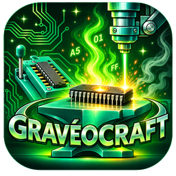
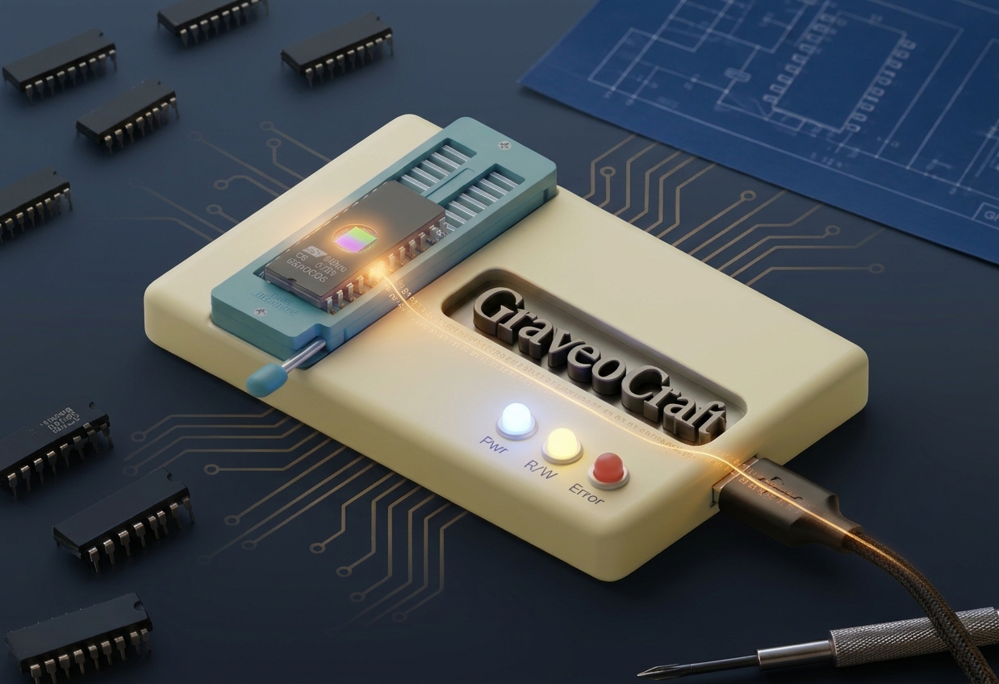
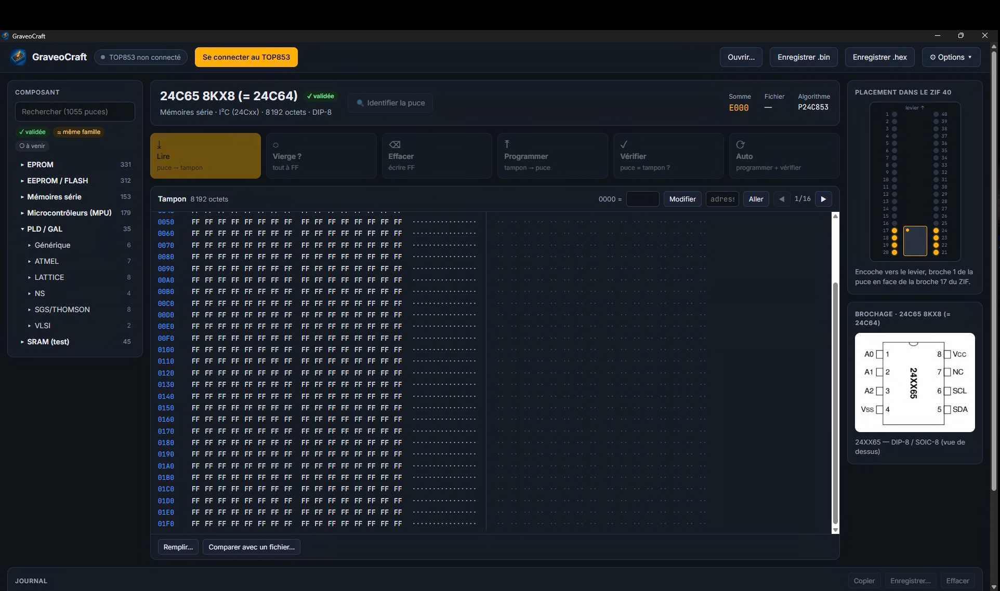

  

<h1 align="center">GravéoCraft</h1>

  <b>Logiciel libre pour programmateurs universels (EPROM, EEPROM, Flash, microcontrôleurs).</b> 
  <i>Free software for universal device programmers (EPROM, EEPROM, Flash, microcontrollers).</i>

  
  
  

  

## Présentation / Overview

GravéoCraft redonne vie aux programmateurs universels dont le logiciel d'origine ne fonctionne plus sous Windows 11, en commençant par le **TOP853 USB** (remplaçant de TopWin6).

L'interface est indépendante du matériel : chaque programmateur est géré par sa propre bibliothèque (circuits supportés et routines), ce qui permettra d'ajouter d'autres modèles (T48, PICkit 2, PICkit 3...).

*GravéoCraft brings universal programmers back to life on Windows 11, starting with the TOP853 USB. The interface is hardware-independent: each programmer has its own driver library, so more models (T48, PICkit 2, PICkit 3...) can be added.*

   
  Version de développement / Development build

## Statut / Status

En développement, pas encore diffusé : le code sera publié ici avec la première version utilisable.

*In development, not yet released: the source code will be published here with the first usable version.*

## Liens / Links

- Site : [graveocraft.fe-be.fr](http://graveocraft.fe-be.fr)
- Contact : graveocraft@fe-be.fr
- Soutien / Support : [Patreon FeBeSoft](https://www.patreon.com/c/FeBeSoft) (le logiciel est et restera gratuit / the software is and will remain free)

Licence prévue / Planned license : GPL-3.0

## Remerciements / Credits

Merci à tous ceux dont le travail a rendu GravéoCraft possible / Thanks to everyone whose work made GravéoCraft possible:

- [Toprammer](https://github.com/mbuesch/toprammer) (Michael Büsch), qui a ouvert la voie pour la famille TOP
- [minipro](https://gitlab.com/DavidGriffith/minipro) et [IMSProg](https://github.com/bigbigmdm/IMSProg), pour leurs idées d'interface et d'architecture
- les équipes de Rust, de [Tauri](https://github.com/tauri-apps/tauri) et de [serialport-rs](https://github.com/serialport/serialport-rs)
- la communauté RC2014 et les passionnés d'informatique rétro
- primrosebank.net, qui conserve la documentation du TOP853 et de TopWin6

---

Un projet <a href="https://fe-be.fr">FeBe</a> - logiciels libres pour makers

